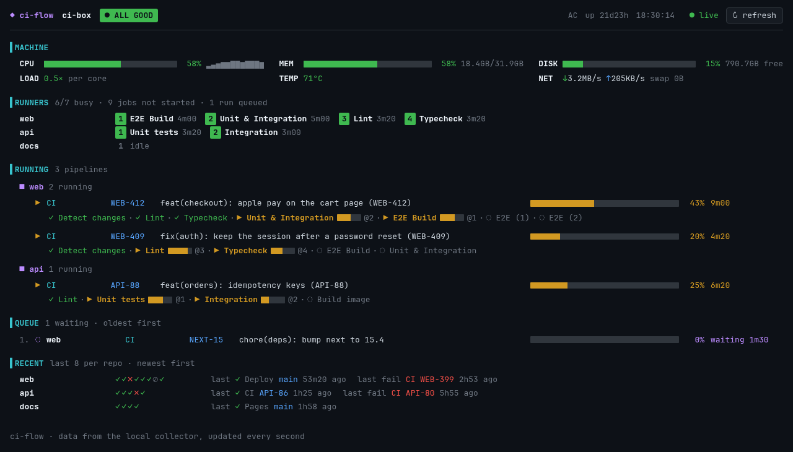

# ci-flow

[](https://github.com/onflow-studio/ci-flow/actions/workflows/test.yml)
[](LICENSE)
[](CONTRIBUTING.md)

Run GitHub Actions on a spare machine and watch it from anywhere.

That old laptop in a drawer is a decent CI box. ci-flow turns it into
self-hosted GitHub Actions runners that are isolated and ephemeral, reachable
only over your [Tailscale](https://tailscale.com) tailnet, with a live
dashboard in the terminal and the browser. More at
[onflow.studio/ci-flow](https://onflow.studio/ci-flow).



## Why

- **Your hardware, your minutes.** Jobs run on a machine you already own:
  no per-minute bill, warm caches, as much memory as you give it.
- **Safe by default.** Every job gets a fresh runner container and its own
  Docker daemon, cleaned afterwards. Service ports never collide between
  slots, and nothing leaks into the next job.
- **Nothing public.** The machine only talks out to GitHub; the dashboard is
  shared on your tailnet, not the internet.
- **You can see it.** Machine health, what every runner is doing, each
  pipeline's jobs live, the queue and recent results, plus push alerts when
  something breaks.
- **Small.** Python standard library, systemd user units and Docker. No
  Kubernetes, no cloud account, no build step.

## How it compares

GitHub Actions stays your CI: workflows, the queue, logs and checks all stay
on GitHub, and jobs opt in with `runs-on: [self-hosted, <label>]`. ci-flow is
the machine underneath, so switching costs one line per job. Compared with
Jenkins or a hosted CI there is no server to run and no pipeline language to
learn; compared with actions-runner-controller there's no Kubernetes; compared
with plain runner containers you get per-job isolation, cleanup and
monitoring.

## Quick start

On the spare machine (Ubuntu, Debian, Arch, Fedora or RHEL-like, with sudo):

```sh
git clone https://github.com/onflow-studio/ci-flow && cd ci-flow
./ci-flow init                                 # prints what's missing
./ci-flow init --yes                           # installs Docker, Tailscale, gh, the collector, ...
ci-flow add your-org/your-repo --runners 2 --labels ci-box
ci-flow apply
tailscale serve --bg --https=7443 http://127.0.0.1:7340   # the dashboard on your tailnet
```

Then in the repo's workflows: `runs-on: [self-hosted, ci-box]`. Watch it with
`cimon` in a terminal or at `https://<machine>.<tailnet>.ts.net:7443`.

The config reference, repo profiles (extra packages, caches) and the
self-test are in [docs/runners.md](docs/runners.md); the design is in
[docs/design.md](docs/design.md).

## Security

**Self-hosted runners run whatever the workflow says, on your machine.** On a
public repository, a pull request from a fork can change the workflow. Before
you point a public repo at ci-flow:

- require approval for fork pull requests from all outside contributors
  (repo Settings → Actions), and
- keep fork pull requests off the self-hosted runner in every workflow that
  uses it:
  `if: github.event_name == 'push' || github.event.pull_request.head.repo.full_name == github.repository`.

A fresh container per job means a job can't leave anything behind for the
next one. It doesn't stop a running job from using your network (your tailnet
included, unless Tailscale ACLs say otherwise), CPU or memory. `ci-flow add`
and `apply` warn about public repos and risky fork settings. See
[SECURITY.md](SECURITY.md) to report a vulnerability.

ci-flow's own tests run on ci-flow, with exactly that fork gate (see
[docs/runners.md](docs/runners.md#ci-flow-tests-itself-on-ci-flow)).

## Set up a machine

On a fresh machine, `ci-flow init` checks everything a CI box needs and plans
only what is missing. It prints the plan; `--yes` runs it, with `sudo` for the
steps marked as needing root and for nothing else. Run it again at any time.

```sh
./ci-flow init           # the plan
./ci-flow init --yes     # do it
```

| Step | What it checks or sets up |
|---|---|
| packages | Docker, Tailscale and gh. Ubuntu and Debian: `apt-get update`, then `docker.io` with `docker-compose-v2` (Ubuntu) or `docker-compose` (Debian). Arch: `pacman -Syu` (a sync without the upgrade is a partial upgrade). Fedora: `moby-engine`. RHEL, Rocky, Alma: Docker's and GitHub's own repos. Tailscale's install script everywhere but Arch |
| services | the `docker` and `tailscaled` services at boot; you in the `docker` group |
| tailscale, gh-auth | joined to a tailnet, gh logged in. Both are interactive logins, so init tells you the command instead of running it |
| linger | `loginctl enable-linger`, so the user units run with nobody logged in |
| install | `ci-flow install` (below) |
| lid | laptops only: on external power, closing the lid mustn't suspend. init reads logind's effective settings first: if the machine already ignores the lid on external power it does nothing, and if your own logind config decides otherwise it tells you instead of overriding it. Otherwise it writes `/etc/systemd/logind.conf.d/ci-flow.conf` (external power and docked: ignore; on battery the lid keeps doing what it did) and sends logind a HUP; it isn't restarted, which would end sessions |
| prune | a weekly user timer, `ci-flow-prune.timer`, removing dangling images and build cache older than `--prune-days` (7). Never volumes, containers or tagged images, so no runner image or cache goes |
| alerts | the dashboards' badge always shows disk, memory, heat, battery and runner problems; push notifications are optional (below) |
| power | coming back after a power cut is a BIOS/UEFI setting ("Restore on AC power loss"); init can only remind you |
| repos | the security warnings for each managed repo (public repos, fork pull request approval) |
| apply | `ci-flow apply` for the repos in the config |

### Push notifications

With `"notify"` in the config, ci-flowd sends a push notification through
[ntfy](https://ntfy.sh) when a problem appears on the badge and when it
clears:

```json
"notify": {"ntfy": "https://ntfy.sh/<a topic only you know>", "level": "crit"}
```

`level` is `crit` (red problems only, the default) or `warn` (yellow ones
too). A problem has to show in two checks in a row, 30 seconds apart, before
it is sent, and be gone for two checks in a row before it is resolved. Anyone
who knows an ntfy.sh topic can read it, so pick a long random one, or use your
own ntfy server; ci-flow never prints the topic. A problem already sent is
sent again when it changes (another runner goes down, warn turns crit) and the
change holds for two checks. Restart ci-flowd after changing `"notify"`.

## Install

```sh
mkdir -p ~/.config/ci-flow
cp config.example.json ~/.config/ci-flow/config.json   # then edit
./install.sh            # installs the code, links cimon and ci-flow into ~/.local/bin, starts ci-flowd
```

`install.sh` (the same as `ci-flow install`) copies the code into
`~/.local/share/ci-flow/lib/<version>/` and points `lib/current` at it; the
version is `git describe` plus a hash of the files. The units and the links in
`~/.local/bin` go through `lib/current`, never through your checkout, so
switching branches in the checkout changes nothing that is running. To
upgrade, pull and run `./install.sh` again: ci-flowd restarts on the new code,
and each runner slot switches to it after its current job. The last two
versions are kept. `ci-flow apply` restarts ci-flowd only when it installs new
code and ci-flowd runs from the install.

The config says what this machine offers: the repos whose runners ci-flow
manages (`"repos"`), and optionally runners set up some other way that the
dashboards should only watch (`"fleets"`: a docker compose project, a systemd
user unit template where `{}` is the runner number, and the repo each runner
slot serves). Set `CIFLOW_CONFIG` to use another path. ci-flowd rereads the
config within a few seconds of a change, so `ci-flow add`, `remove` and
`apply` show on the dashboards without a restart; a config that doesn't load
keeps the last good one (and says so in `journalctl --user -u ci-flowd`).

## Runners

```sh
ci-flow add owner/repo --runners 2 --labels myrepo   # add it to the config
ci-flow apply --dry-run                              # see what would change
ci-flow apply                                        # install, render, build, start
ci-flow status                                       # also says when a repo's profile changed since apply
ci-flow remove owner/repo [--purge]
```

Each runner slot is a long-lived Docker daemon plus a fresh runner container
per job, registered with a single-use (JIT) config and running under a
`ci-flow-runner@<project>-<slot>` systemd user unit. Jobs opt in with
`runs-on: [self-hosted, <label>]`. What a repo's jobs need in the runner image
(extra packages, caches, Node heap) comes from `.github/ci-flow.toml` on its
default branch. [docs/runners.md](docs/runners.md) has the config and profile
reference, the security notes, and how to run the self-test.

## ci-flowd

The collector. It polls the machine (`/proc`, `/sys`), `docker`,
`systemctl --user` and the GitHub API through `gh`, and keeps one snapshot of
the CI machine. It listens on 127.0.0.1 only:

| Endpoint | |
|---|---|
| `GET /api/snapshot` | the snapshot as JSON |
| `GET /api/events` | server-sent events, one snapshot per second |
| `POST /api/refresh` | collect now instead of waiting for the next interval |
| `GET /api/whoami` | the viewer's Tailscale identity, behind `tailscale serve` |
| `GET /` | the web dashboard |

Each snapshot carries the raw data and a `view`: the same derivation both
dashboards use (health badge, busy slots, running and queued runs grouped the
way they're shown, recent results), built by `ciflow/model.py`.

`install.sh` writes `~/.config/systemd/user/ci-flowd.service` from
`systemd/ci-flowd.service`, running `lib/current/ci-flowd`. A systemd user session doesn't see PATH entries
added by your shell (mise, asdf, …), so the unit gets an explicit PATH. When
`gh` comes from mise or asdf it is reached through their shims directory, so
upgrading `gh` needs no reinstall; otherwise the PATH points at where `gh` is
found now, and you run `install.sh` again after moving it. If `gh` can't read
its keyring from the headless session, put `GH_TOKEN=…` in
`~/.config/ci-flow/env`, which the unit loads.

```sh
systemctl --user status ci-flowd
journalctl --user -u ci-flowd -f
```

## cimon

The terminal dashboard: the machine's health, what each self-hosted runner is
doing, running and queued pipelines per repo, and recent results.

```sh
cimon            # live view (q quit · r refresh)
cimon --once     # print one frame and exit
```

cimon reads the collector's snapshot when ci-flowd is running. Otherwise it
collects in-process, which needs the config file, and tries the collector
again every 10 seconds, switching back once it answers. It also falls back
when the collector serves a snapshot version it doesn't understand (e.g. an
old daemon still running after an upgrade). The footer shows which source is
in use and why.

## Web dashboard

ci-flowd serves the dashboard at `/`: the same sections as cimon, updated live
over `/api/events`, with links to each run and job on GitHub and a refresh
button. It's one static HTML file (`ciflow/web/index.html`), no build step and
no external assets, and it works on a phone.

ci-flowd only listens on 127.0.0.1. To open it from your other devices, share
it on your tailnet with `tailscale serve`, picking an HTTPS port that's free
(`tailscale serve status` lists the ones in use):

```sh
tailscale serve --bg --https=7443 http://127.0.0.1:7340
# → https://<machine>.<tailnet>.ts.net:7443, reachable only from your tailnet
tailscale serve --https=7443 off   # stop sharing
```

Tailscale terminates HTTPS and adds the viewer's identity to each request
(`Tailscale-User-Login`, `Tailscale-User-Name`); the page shows who is viewing.
There is no separate login: access is whoever can reach the machine on your
tailnet, which you control with Tailscale ACLs. Don't use `tailscale funnel`,
which would make the dashboard public.

## Environment

| Variable | Default | Used by |
|---|---|---|
| `CIFLOW_CONFIG` | `~/.config/ci-flow/config.json` | ci-flow, ci-flowd, cimon without a collector |
| `CIFLOW_PORT` | `7340` | ci-flowd |
| `CIFLOW_URL` | `http://127.0.0.1:7340` | cimon |
| `CIFLOW_HOME` | `~/.local/share/ci-flow` | ci-flow (installed code in `lib/`, rendered runner projects in `projects/`) |

## Tests

```sh
python3 -m unittest discover -s tests
```

See [CONTRIBUTING.md](CONTRIBUTING.md).

## License

MIT, see [LICENSE](LICENSE).
